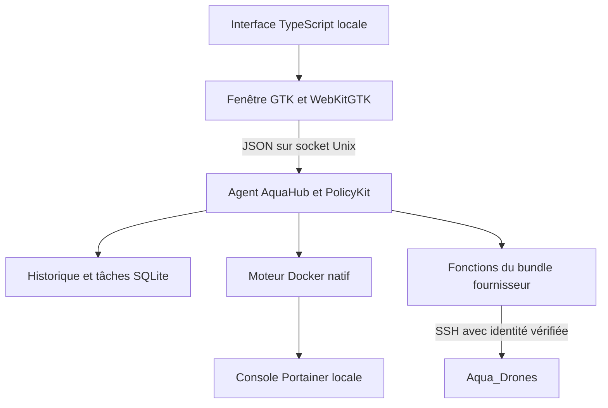

# AquaHub

AquaHub est une application de bureau pour superviser les services d’un poste
Aqua Hub, consulter leurs journaux et lancer les opérations de maintenance
prises en charge par le bundle installé.

Interface monochrome, navigation latérale, thèmes clair et sombre. La cible
actuelle est **Debian 13 amd64 avec GNOME**. Le code AquaHub est distribué sous
[licence MIT](LICENSE).

**État : préproduction 0.2.7.** Les sources et les tests sont publics. Les
livraisons installables sont indiquées dans les [Releases](https://github.com/mehdi7129/aquahub/releases).
Le paquet de mise à jour AquaHub seul nécessite une installation existante.
Le bundle fournisseur, ses images et ses configurations client sont séparés.


Capture de l’interface 0.2.7 avec données fictives uniquement.
[Voir le mode sombre](docs/assets/aquahub-demo-dark.png).

## Télécharger la préversion

[Télécharger AquaHub 0.2.7 pour Debian 13 amd64 (.deb)](https://github.com/mehdi7129/aquahub/releases/download/v0.2.7/aquahub-application_0.2.7_amd64.deb).

Ce paquet met à jour une installation AquaHub existante. Ouvrir le fichier
avec le gestionnaire de paquets graphique, valider l’installation, puis fermer
et rouvrir AquaHub. Il ne contient ni le bundle fournisseur ni le kit initial.
Les [notes, instructions et empreintes](https://github.com/mehdi7129/aquahub/releases/tag/v0.2.7)
accompagnent les quatre fichiers de la Release. Les archives « Source code »
sont destinées au développement.

La livraison est marquée **Pre-release** : téléchargement manuel. Le bouton
de mise à jour actuel propose uniquement les Releases normales compatibles.

## Fonctionnalités

| Fonction | État dans 0.2.7 | Limite à connaître |
| --- | --- | --- |
| Supervision | Huit services reconnus, contours colorés et détail par service | État du conteneur et santé distincts ; données anciennes neutralisées |
| Relances | Tâche ciblée visible, résultat et observation après intervention | Un service à la fois ; WireGuard utilise son action dédiée |
| WireGuard | Vérification du tunnel et réactivation du profil existant sans mot de passe PC pour l’opérateur autorisé | Conteneur déjà en cours et profil reconnu ; démarrage générique toujours protégé, liaison distante distincte |
| Journaux et historique | Logs techniques, événements, extraits de panne et exports | Collecte et conservation bornées ; aucun historique exhaustif garanti |
| Aqua_Drones | Configuration ciblée dans l’ordre choisi, sans mot de passe administrateur du PC et sans réécriture du hub actif | Compte autorisé, identité confirmée et cible déjà couverte par le hub ; un appareil à la fois, accès SSH distincts |
| Progression | Numéro du drone, étapes validées et remplissage conservé pendant l’attente | Les cinq contrôles manuels restent séparés |
| Outils complémentaires | Accès à GCS, Fleet Controller et Portainer | Le compte Portainer est distinct des opérations courantes AquaHub |
| Mise à jour AquaHub | Recherche de Releases normales, téléchargement vérifié et installation confirmée | Les préversions publiques s’installent manuellement ; un ZIP de sources n’est pas un installateur |
| Mise à jour du bundle | Inspection et application des livraisons `image-refresh-v1` reconnues | Le futur flux Git + registre du fournisseur n’est pas encore implémenté |
| Installation | Constructeur de paquet applicatif et assistant de kit complet hors ligne | Kit fournisseur/client externe, privé s’il contient des configurations ou secrets |
| Identité dans le bureau | Nom AquaHub, identifiant natif et icône alignés sur le lanceur existant | Fermer l’ancienne fenêtre avant de rouvrir après mise à niveau ; portée des contrôles GNOME dans les tests |

Les adresses IP existantes ne sont pas administrées par l’interface. Les actions
réseau sans précontrôle suffisant restent bloquées. Les contrôles manuels des
drones ne sont pas validés automatiquement.

Les états utilisent des contours discrets vert, rouge, orange ou gris ; une
observation périmée n’est pas affichée comme un service actuellement en cours.
Les relances de Réseau du bundle et GCS Reactor comparent les adresses et les
routes avant et après. WireGuard dispose d’une action dédiée qui remet en
service les seuls éléments déjà prévus par son profil, sans redémarrer le
conteneur historique. Les scripts et configurations du bundle sont conservés.
Son état de tunnel est séparé
de celui du conteneur. L’absence d’échange récent ne constitue pas une panne
ni une preuve d’absence de drone. Voir le [contrat WireGuard](docs/WIREGUARD.txt).
La santé fonctionnelle reste distincte de l’état.

## Évolutions récentes

| Version | Changements principaux |
| --- | --- |
| 0.2.0 | Canal applicatif séparé du bundle, paquet léger, suivi nommé des configurations et détail des contrôles manuels |
| 0.2.1 | Précontrôle sans mot de passe administrateur, exports des logs, relances réseau ciblées et supervision simplifiée |
| 0.2.2 | Barre de progression corrigée, retour visuel des relances, gestion de l’ancien cache et des réponses perdues, titres et espacements harmonisés |
| 0.2.3 | Identité native, nom et icône du bureau harmonisés ; assistant distinct sans second raccourci dans le menu |
| 0.2.4 | Configuration d’un Aqua_Drone sans demande de mot de passe administrateur du PC, avec contrôles de cible et de maintenance conservés |
| 0.2.5 | Hub actif conservé pendant la configuration ciblée, scripts fournisseur intacts ; capture privée de reconnexion et CI générique |
| 0.2.6 | État du tunnel WireGuard distinct du conteneur, vérification consultative et réactivation ciblée du profil existant, sans redémarrage générique |
| 0.2.7 | Réactivation WireGuard sans mot de passe PC pour le compte opérateur, avec confirmation et gardes conservées |

Les [notes de version](CHANGELOG.md) décrivent le code livré. Les
[résultats de validation](docs/TESTS.txt) séparent tests génériques, parcours
graphiques, recettes de paquet et essais matériels. Les contrôles locaux des
sources 0.2.7 passent **335 tests Python sans omission**, avec les préconditions
explicites du banc, la vérification TypeScript et **38 tests JavaScript**.
La publication ajoute **8 tests isolés** de brouillon, reprise et refus ;
ils ne modifient aucun service et ne contactent pas GitHub.
La suite comprend des lectures Docker réelles et des exécutions de scripts
fournisseur sur transports simulés. La recette WebKit WireGuard de 0.2.6 passe
**15 scénarios à 100 % et 15 à 200 %**, avec données synthétiques et les deux
thèmes. Ces résultats ne qualifient pas une installation client complète,
une flotte ou une liaison distante ; les recettes de paquet sont consignées
séparément pour chaque artefact dans les tests.

La recette historique 0.2.5 reste documentée séparément : 291 tests Python,
28 tests JavaScript et une configuration matérielle d’Aqua_Drone_5 avec
redémarrage et retour vérifiés, sans changement des IP/routes ni des fichiers
du hub. Les cinq contrôles matériels manuels restent distincts. Les résultats
d’identité native 0.2.3 ne constituent pas de nouveaux essais 0.2.6.

## Prochains chantiers

- **Consolidation V1 et reconnexion Ethernet** : qualifier le retour
  d’Internet après rebranchement du RJ45 et le distinguer de l’état du tunnel
  WireGuard. L’outil de capture est disponible ; la réactivation ciblée 0.2.6
  ne constitue pas un diagnostic de la cause initiale. La configuration ciblée
  préserve le hub actif ; la recette d’une flotte physique et la récupération
  après incident restent à compléter. Voir le
  [plan consolidé](docs/PLAN_V1_ET_RECONNEXION_ETHERNET_2026-10-22.txt).
  Aucune modification des scripts fournisseur ou des IP n’est autorisée par ce plan.
- **Reprise et rétention** : les scénarios, protections et critères de test
  sont définis dans les plans de [reprise après interruption](docs/PLAN_REPRISE_APRES_INTERRUPTION.txt)
  et de [conservation des fichiers](docs/PLAN_RETENTION_ET_QUOTAS.txt).
  Leur implémentation reste un lot distinct ; aucun nettoyage n’est activé.
- **Bundle fournisseur v1.0.1** : préparer le flux Git + registre, préserver
  les configurations client et qualifier son correctif officiel de démarrage
  WireGuard, distinct de la réactivation 0.2.6. Voir le
  [plan distinct](docs/PLAN_INTEGRATION_BUNDLE_V101_2026-10-21.txt).
- **Distribution commerciale** : qualifier le kit générique, les artefacts
  publics et les signatures. Voir la [feuille de route](docs/ETAT_ET_FEUILLE_DE_ROUTE.txt).

## Reprendre le développement

Commencer par [le guide de reprise](docs/REPRISE_DEVELOPPEMENT.txt). Il décrit
le poste de développement, les commandes, les points d’entrée et les pièges à
éviter. Les commandes ci-dessous s’exécutent sur un poste de développement,
depuis la racine du dépôt ; elles ne sont pas le parcours d’installation client.
Lire ensuite les [décisions techniques](docs/DECISIONS_TECHNIQUES.txt) pour
comprendre les choix à préserver, puis le document lié au chantier choisi.

```sh
cd frontend
npm ci
npm run check
npm test
npm run build
cd ..
PYTHONPATH=agent:desktop /usr/bin/python3 -m unittest discover -s tests -q
```

Pour découvrir l’interface avec des données fictives, sans agent ni service réel :

```sh
PYTHONPATH=agent:desktop /usr/bin/python3 -m aquahub_desktop \
  --demo --no-agent \
  --socket /tmp/aquahub-demo-unused.sock \
  --state-dir ./local-private/demo
```

Les dépendances système, dont GTK, WebKitGTK et les outils de compilation,
sont listées dans le guide. La fenêtre se lance avec un compte utilisateur,
sans `sudo`. Le mode de démonstration n’est pas une validation matérielle.

## Architecture



Le renderer ne reçoit pas le socket Docker, les clés SSH ou les jetons. Le
produit installé utilise un agent système ; le mode de développement possède
des chemins d’état distincts. Les invariants sont détaillés dans
[l’architecture](docs/ARCHITECTURE.txt) et [la sécurité](docs/SECURITE.txt).

## Documentation

| Besoin | Document |
| --- | --- |
| Installer le poste de dev et lancer la démo | [Reprise du développement](docs/REPRISE_DEVELOPPEMENT.txt) |
| Comprendre les modules et les flux | [Architecture](docs/ARCHITECTURE.txt) |
| Comprendre les choix et leurs raisons | [Décisions techniques](docs/DECISIONS_TECHNIQUES.txt) |
| Respecter les droits, les identités et le réseau | [Sécurité](docs/SECURITE.txt) |
| Préparer un contenu publiable sans données privées | [Confidentialité du dépôt](docs/CONFIDENTIALITE_DEPOT_PUBLIC.txt) |
| Exécuter les tests et comprendre leur portée | [Tests](docs/TESTS.txt) |
| Comprendre les vérifications automatiques du dépôt | [CI](docs/CI.txt) |
| Préparer une capture privée après reconnexion RJ45 | [Diagnostic Ethernet](docs/DIAGNOSTIC_RECONNEXION_ETHERNET.txt) |
| Comprendre et réactiver le tunnel WireGuard reconnu | [WireGuard](docs/WIREGUARD.txt) |
| Comprendre le protocole local et les tâches | [API et données](docs/API_ET_DONNEES.txt) |
| Raccorder une livraison fournisseur | [Contrat du bundle](docs/CONTRAT_BUNDLE.txt) |
| Préparer l’intégration fournisseur v1.0.1 | [Plan complémentaire](docs/PLAN_INTEGRATION_BUNDLE_V101_2026-10-21.txt) |
| Comprendre les corrections d’affichage 0.2.2 | [Plan des corrections visuelles](docs/PLAN_CORRECTIONS_VISUELLES_2026-10-21.txt) |
| Corriger le nom et l’icône dans GNOME | [Plan d’identité bureau](docs/PLAN_IDENTITE_BUREAU_2026-10-21.txt) |
| Construire un paquet et préparer une publication | [Construction et publication](docs/PUBLICATION.txt) |
| Publier une préversion applicative qualifiée | [Releases](docs/RELEASES.txt) |
| Résoudre un problème sur le poste de dev | [Dépannage](docs/DEPANNAGE.txt) |
| Choisir le prochain chantier | [État et feuille de route](docs/ETAT_ET_FEUILLE_DE_ROUTE.txt) |
| Utiliser les fonctions de la GUI | [Guide utilisateur](docs/GUIDE_UTILISATEUR.txt) |
| Proposer une modification | [Contribution](CONTRIBUTING.md) |

## Mises à jour

L’onglet **Mises à jour** distingue deux canaux :

- **Application AquaHub** consulte les Releases publiques de
  `mehdi7129/aquahub`. Un commit, une branche ou une archive de sources ne
  constitue pas une mise à jour installable. Le paquet attendu est
  `aquahub-application_X.Y.Z_amd64.deb` ; il remplace uniquement AquaHub sur
  un poste déjà initialisé. Le téléchargement est vérifié, puis
  l’installation nécessite une confirmation et l’autorisation système.
- **Bundle Aqua Hub** concerne les services et configurations du fournisseur.
  Son URL et ses accès restent distincts. Un jeton de déploiement Git et
  registre Docker ne donne pas accès à l’API des Releases GitLab. La procédure
  fournisseur Git + registre reste à qualifier.

Le canal applicatif vérifie le SHA-256 fourni dans les métadonnées GitHub
reçues par HTTPS et les champs du paquet Debian. Il ne possède pas encore
une signature d’éditeur indépendante de GitHub. La préversion publique 0.2.7
contient l’application seule ; aucun kit initial public qualifié n’est annoncé.
Voir les [notes de version](CHANGELOG.md) et la
[procédure de publication](docs/PUBLICATION.txt).

Le constructeur actuel produit un kit d’installation complet à partir d’un
payload externe. Un kit contenant des clés ou des configurations client reste
privé et ne doit jamais être joint à une publication publique. Une licence MIT
sur AquaHub ne change pas les licences des composants tiers.

## Licence

[MIT](LICENSE), pour le code AquaHub présent dans ce dépôt. Les dépendances et
les logiciels du fournisseur conservent leurs propres licences ; voir
[les composants tiers](THIRD_PARTY.txt).
