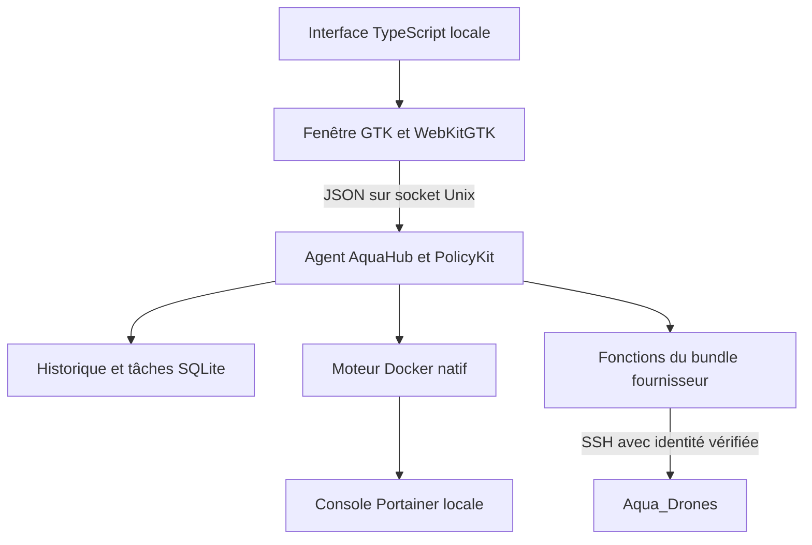

# AquaHub

AquaHub est une application de bureau pour superviser les services d’un poste
Aqua Hub, consulter leurs journaux et lancer les opérations de maintenance
prises en charge par le bundle installé.

Interface monochrome, navigation latérale, thèmes clair et sombre. La cible
actuelle est **Debian 13 amd64 avec GNOME**. Le code AquaHub est distribué sous
[licence MIT](LICENSE).

**État : préproduction 0.1.2.** Les sources et les tests sont disponibles ;
aucun installateur public qualifié n’est encore proposé. Le bundle fournisseur,
ses images et ses configurations privées doivent être obtenus séparément.


## Fonctionnalités

- Supervision des huit composants reconnus du bundle, avec état du conteneur
  distinct de son contrôle de santé.
- Détail d’un service, redémarrages autorisés et tâches de maintenance suivies.
- Journaux techniques, événements persistants et extraits de panne bornés.
- Accès aux interfaces GCS, Fleet Controller et Portainer.
- Inventaire Aqua_Drones, identité SSH, précontrôles et configuration d’une cible
  à partir des fonctions du fournisseur.
- Inspection d’archives de mise à jour et application des seules livraisons
  répondant au contrat `image-refresh-v1`.

Les adresses IP existantes ne sont pas administrées par l’interface. Les actions
réseau sans précontrôle suffisant restent bloquées. Les contrôles matériels des
drones restent manuels.

## Reprendre le développement

Commencer par [le guide de reprise](docs/REPRISE_DEVELOPPEMENT.txt). Il décrit
le poste de développement, les commandes, les points d’entrée et les pièges à
éviter. Les commandes ci-dessous s’exécutent sur un poste de développement,
depuis la racine du dépôt ; elles ne sont pas le parcours d’installation client.

```sh
cd frontend
npm ci
npm run check
npm test
npm run build
cd ..
PYTHONPATH=agent:desktop /usr/bin/python3 -m unittest discover -s tests -q
```

Pour découvrir l’interface avec des données fictives, sans agent ni service réel :

```sh
PYTHONPATH=agent:desktop /usr/bin/python3 -m aquahub_desktop \
  --demo --no-agent \
  --socket /tmp/aquahub-demo-unused.sock \
  --state-dir ./local-private/demo
```

Les dépendances système, dont GTK, WebKitGTK et les outils de compilation,
sont listées dans le guide. La fenêtre se lance avec un compte utilisateur,
sans `sudo`. Le mode de démonstration n’est pas une validation matérielle.

## Architecture



Le renderer ne reçoit pas le socket Docker, les clés SSH ou les jetons. Le
produit installé utilise un agent système ; le mode de développement possède
des chemins d’état distincts. Les invariants sont détaillés dans
[l’architecture](docs/ARCHITECTURE.txt) et [la sécurité](docs/SECURITE.txt).

## Documentation

| Besoin | Document |
| --- | --- |
| Installer le poste de dev et lancer la démo | [Reprise du développement](docs/REPRISE_DEVELOPPEMENT.txt) |
| Comprendre les modules et les flux | [Architecture](docs/ARCHITECTURE.txt) |
| Respecter les droits, les identités et le réseau | [Sécurité](docs/SECURITE.txt) |
| Exécuter les tests et comprendre leur portée | [Tests](docs/TESTS.txt) |
| Comprendre le protocole local et les tâches | [API et données](docs/API_ET_DONNEES.txt) |
| Raccorder une livraison fournisseur | [Contrat du bundle](docs/CONTRAT_BUNDLE.txt) |
| Construire un paquet et préparer une publication | [Construction et publication](docs/PUBLICATION.txt) |
| Résoudre un problème sur le poste de dev | [Dépannage](docs/DEPANNAGE.txt) |
| Choisir le prochain chantier | [État et feuille de route](docs/ETAT_ET_FEUILLE_DE_ROUTE.txt) |
| Utiliser les fonctions de la GUI | [Guide utilisateur](docs/GUIDE_UTILISATEUR.txt) |
| Proposer une modification | [Contribution](CONTRIBUTING.md) |

## Mises à jour

Ce dépôt accueillera les versions publiques d’AquaHub et leurs notes. Le bouton
permettant de mettre à jour **l’application AquaHub elle-même** n’est pas encore
implémenté. Ce futur canal sera distinct des mises à jour du bundle fournisseur
et de la configuration des drones.

Le constructeur actuel produit un kit d’installation complet à partir d’un
payload externe. Un kit contenant des clés ou des configurations client reste
privé et ne doit jamais être joint à une publication publique. Une licence MIT
sur AquaHub ne change pas les licences des composants tiers.

## Licence

[MIT](LICENSE), pour le code AquaHub présent dans ce dépôt. Les dépendances et
les logiciels du fournisseur conservent leurs propres licences ; voir
[les composants tiers](THIRD_PARTY.txt).
